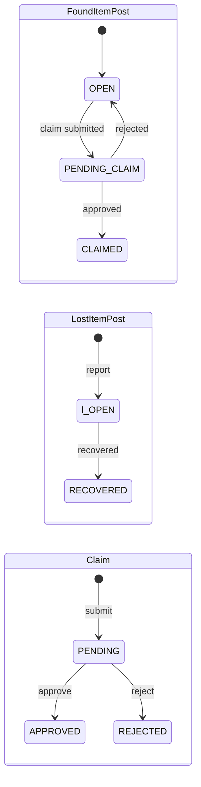

# TrackBack — API Reference

Complete list of the backend's HTTP endpoints with request/response schemas and types.

- **Stack:** Node.js + Express (backend) · PostgreSQL + Prisma (data) · Layered architecture (Route → Controller → Service → Repository)
- **Base URL:** `http://localhost:8080` — routers are mounted at the **root** (there is no `/api/v1` prefix). `GET /` is a plain health check (`"Hello World"`).
- **Content type:** `application/json`, except the multipart endpoints marked below.

## Conventions

- **Auth:** 🔒 = requires a logged-in user · 🔓 = public. Authentication is a JWT stored in an **HTTP-only cookie `token`** (set by `POST /auth/login`, 1 day, or 30 days with `rememberMe: true`). The `secureRoute` middleware verifies the cookie and puts `userId` on the request. Authorization (owner-only, etc.) is checked per endpoint in the service layer.
- **Pagination:** list endpoints take `?page=&limit=`. Defaults and maxima differ per endpoint and are listed on each one.
- **Dates:** all timestamps are ISO 8601 strings (`2026-10-18T09:00:00.000Z`).
- **IDs:** UUID strings.

### Error shape

Every error goes through the central error handler and returns:

```jsonc
{
  "status": "error",
  "code": "POST_ALREADY_CLAIMED",   // optional — present only on domain errors
  "message": "This post is no longer available for claiming"
}
```

- Domain errors carry a `code` (see the [error index](#error-index)); generic `400 / 401 / 403 / 404 / 409` errors have `message` only.
- Unhandled errors return `500 { "status": "error", "message": "Internal server error" }` (no code).
- Multipart errors (multer) return `400` with codes like `LIMIT_FILE_SIZE` (max 5 MB) or `LIMIT_UNEXPECTED_FILE` (wrong field name).

### Response wrapping — read this once

Wrapping is **not uniform** across the codebase, so each endpoint below documents its exact envelope:

| Envelope | Used by |
|---|---|
| `{ data, message }` | login, register, create lost/found item, upload image |
| `{ response, message }` | update profile (note the key is `response`, not `data`) |
| `{ message }` only | logout, claim invite, delete image, forgot/reset password |
| bare payload | every list, detail, update, review, recover, delete, notification, matching endpoint |

---

## Endpoint index

| # | Method | Path | Auth | Purpose |
|---|---|---|---|---|
| 1 | POST | `/auth/login` | 🔓 | Log in, get session cookie |
| 2 | POST | `/auth/register` | 🔓 | Create account |
| 3 | DELETE | `/auth/logout` | 🔓 | Clear session cookie |
| 4 | POST | `/auth/forgot-password` | 🔓 | Email a reset link |
| 5 | POST | `/auth/reset-password` | 🔓 | Set a new password with token |
| 6 | GET | `/users/me` | 🔒 | Current user's profile |
| 7 | GET | `/users/:id` | 🔒 | A user's public profile |
| 8 | PATCH | `/users/me` | 🔒 | Update own profile |
| 9 | GET | `/lost-items` | 🔒 | List/search lost items |
| 10 | GET | `/lost-items/:id` | 🔒 | Lost item detail |
| 11 | POST | `/lost-items` | 🔒 | Report lost item (+ auto matching) |
| 12 | PATCH | `/lost-items/:id` | 🔒 (owner) | Edit own lost item |
| 13 | PATCH | `/lost-items/:id/recover` | 🔒 (owner) | Mark lost item RECOVERED |
| 14 | DELETE | `/lost-items/:id` | 🔒 (owner) | Delete own lost item |
| 15 | GET | `/found-items` | 🔒 | List/search found items |
| 16 | GET | `/found-items/:id` | 🔒 | Found item detail |
| 17 | POST | `/found-items` | 🔒 | Report found item (+ auto matching) |
| 18 | PATCH | `/found-items/:id` | 🔒 (owner) | Edit own found item |
| 19 | DELETE | `/found-items/:id` | 🔒 (owner) | Delete own found item |
| 20 | GET | `/items/search` | 🔒 | Unified search across both post types |
| 21 | GET | `/my-posts` | 🔒 | Current user's own posts (both types) |
| 22 | POST | `/found-items/:id/claims` | 🔒 | Submit a claim ("this is mine") |
| 23 | POST | `/found-items/:id/claim-invites` | 🔒 (finder) | "I have this" invite |
| 24 | GET | `/claims` | 🔒 | List my claims / claims to review |
| 25 | GET | `/claims/:id` | 🔒 (party) | Claim detail |
| 26 | PATCH | `/claims/:id/review` | 🔒 (finder) | Approve / reject a claim |
| 27 | POST | `/matching/run/:itemId` | 🔒 (owner) | Run matching for a post |
| 28 | GET | `/lost-items/:id/matches` | 🔒 (owner) | Candidate found items |
| 29 | GET | `/found-items/:id/matches` | 🔒 (owner) | Candidate lost items |
| 30 | GET | `/notifications` | 🔒 | List notifications + unread count |
| 31 | PATCH | `/notifications/:id/read` | 🔒 | Mark one as read |
| 32 | PATCH | `/notifications/read-all` | 🔒 | Mark all as read |
| 33 | POST | `/media/image` | 🔒 | Upload images (Cloudinary) |
| 34 | DELETE | `/media/image` | 🔒 | Delete images by publicId |

---

## Shared schemas

Types referenced by the endpoints below.

```ts
type RoleType = "USER" | "ADMIN";

interface User {
  id: string;
  name: string;
  email: string;
  profileUrl: string | null;       // avatar URL
  profilePublicId: string | null;  // Cloudinary id of the avatar
  about: string | null;            // omitted by auth login/register responses
  role: RoleType;
  createdAt: string;
  updatedAt: string;
  deletedAt: string | null;
}

type LostItemStatus = "OPEN" | "RECOVERED" | "CLOSED";

interface LostItemPost {
  id: string;
  title: string;
  description: string;
  category: string;
  lastSeenLocation: string;
  lastSeenDate: string;
  status: LostItemStatus;
  photoUrl: string | null;
  userId: string;
  createdAt: string;
  updatedAt: string;
}

type FoundItemStatus = "OPEN" | "PENDING_CLAIM" | "CLAIMED" | "CLOSED";

interface FoundItemPost {
  id: string;
  title: string;
  description: string;
  category: string;
  foundLocation: string;
  foundDate: string;
  status: FoundItemStatus;
  photoUrl: string | null;
  userId: string;
  createdAt: string;
  updatedAt: string;
}

// Browse item = either post shape + a discriminator for the UI
type BrowseItem = (LostItemPost & { type: "lost" }) | (FoundItemPost & { type: "found" });

interface MyPost {  // normalized shape for the My Posts screen
  id: string;
  postType: "LOST" | "FOUND";
  title: string;
  description: string;
  category: string;
  location: string;   // lastSeenLocation or foundLocation
  date: string;       // lastSeenDate or foundDate
  status: LostItemStatus | FoundItemStatus;
  photoUrl: string | null;
  userId: string;
  createdAt: string;
  updatedAt: string;
}

type ClaimStatus = "PENDING" | "APPROVED" | "REJECTED";

interface ClaimResponse {
  id: string;
  status: ClaimStatus;
  justification: string;
  itemDetails: string;
  proofPhotoUrl: string | null;
  foundItemPostId: string;
  claimantUserId: string;
  createdAt: string;
  updatedAt: string;
}

interface ClaimDetailResponse {
  id: string;
  status: ClaimStatus;
  claimant: { id: string };
  claim: {
    justification: string;
    itemDetails: string;
    proofPhotoUrl: string | null;
  };
  foundItem: {
    id: string;
    title: string;
    category: string;
    description: string;
    foundLocation: string;
    foundDate: string;
    photoUrl: string | null;
  };
  createdAt: string;
  updatedAt: string;
}

interface NotificationResponse {
  id: string;
  message: string;
  isRead: boolean;
  createdAt: string;
  userId: string;
  relatedItemId: string | null;    // deep-link target post
  relatedClaimId: string | null;   // deep-link target claim
}

interface UploadedImage {
  url: string;      // Cloudinary secure URL
  publicId: string; // keep for later deletion
}
```

---

## 1. Auth — `/auth`

### 1.1 `POST /auth/login` 🔓

**Request body**

```ts
{
  email: string;        // required
  password: string;     // required
  rememberMe?: boolean; // extends cookie 1 day → 30 days
}
```

**Response `200`** — also sets the HTTP-only `token` cookie:

```ts
{
  data: {
    accessToken: string; // the same JWT that is in the cookie
    userInfo: User;      // without `about`
  };
  message: "Login Successfully";
}
```

Errors: `401` invalid email or password.

### 1.2 `POST /auth/register` 🔓

**Request body**

```ts
{
  name: string;         // required
  email: string;        // required
  password: string;     // required (non-empty; no length rule enforced here)
  role?: RoleType;      // optional, reserved — omit for a regular account
}
```

**Response `201`**

```ts
{ data: User /* without `about` */, message: "Register Successfully" }
```

Errors: `409` "User already exists".

### 1.3 `DELETE /auth/logout` 🔓

Clears the `token` cookie. No body.

**Response `200`** — `{ message: "Logged out successfully" }`

### 1.4 `POST /auth/forgot-password` 🔓

**Request body** — `{ email: string }`

Emails a signed reset link (15-minute expiry). In development the response also echoes the token so it can be tested without mail access.

**Response `200`**

```ts
{
  message: "Forgot password email sent successfully";
  resetToken?: string; // development only
  resetUrl?: string;   // development only
}
```

Errors: `404` "Account has not been created with this email".

### 1.5 `POST /auth/reset-password` 🔓

**Request body**

```ts
{ token: string;    // from the emailed link
  password: string } // required, min 4 chars
```

**Response `200`** — `{ message: "Password reset successfully" }` (a confirmation email is sent)

Errors: `401` "Reset link is invalid or expired".

---

## 2. Users — `/users`

### 2.1 `GET /users/me` 🔒

**Response `200`** — `User` (bare, includes `about`)

### 2.2 `GET /users/:id` 🔒

Path: `id: string` (UUID). Any logged-in user may view a profile (used for post-owner cards).

**Response `200`** — `User` (bare)

Errors: `404` "User not found".

### 2.3 `PATCH /users/me` 🔒

Multipart/form-data when uploading an avatar, JSON otherwise. At least one field must be provided.

**Request**

```ts
{
  name?: string;
  email?: string;      // must be unique — 409 if taken
  password?: string;   // plain text, hashed server-side
  about?: string | null;
  profileUrl?: File;   // multipart file field "profileUrl" — avatar image
}
```

**Response `200`** — note the envelope key is `response`:

```ts
{ response: User, message: "Update Successfully" }
```

Errors: `409` "Email is already in use".

---

## 3. Lost items — `/lost-items`

### 3.1 `GET /lost-items` 🔒

**Query**

```ts
{
  keyword?: string;   // matches title, description, category, lastSeenLocation
  category?: string;  // exact (case-insensitive)
  location?: string;  // substring of lastSeenLocation
  dateFrom?: string;  // ISO date, filters lastSeenDate >=
  dateTo?: string;    // ISO date, filters lastSeenDate <=
  status?: "OPEN" | "RECOVERED" | "CLOSED";
  page?: number;      // default 1
  limit?: number;     // default 10, max 100
}
```

**Response `200`**

```ts
{ items: LostItemPost[]; total: number; page: number }
```

### 3.2 `GET /lost-items/:id` 🔒

**Response `200`** — `LostItemPost` (bare) · Errors: `404` "Lost item not found".

### 3.3 `POST /lost-items` 🔒

**Request body**

```ts
{
  title: string;            // required
  description: string;      // required
  category: string;         // required
  lastSeenLocation: string; // required
  lastSeenDate: string;     // required, valid date
  photoUrl?: string | null; // upload via /media/image first
}
```

Side effects: creates the post with `status: "OPEN"`, then **runs matching** (see §7) which may notify both sides.

**Response `201`**

```ts
{ data: LostItemPost, message: "Lost item reported successfully" }
```

### 3.4 `PATCH /lost-items/:id` 🔒 (owner, post must be OPEN)

Partial update — every field optional, at least one required.

**Request body**

```ts
{
  title?: string;
  description?: string;
  category?: string;
  lastSeenLocation?: string;
  lastSeenDate?: string;   // valid date
  photoUrl?: string | null;
}
```

**Response `200`** — `LostItemPost` (bare, updated)

Errors: `403` not owner · `409` "Only open lost items can be edited".

### 3.5 `PATCH /lost-items/:id/recover` 🔒 (owner)

No body. Marks the post recovered — for items found outside the claim flow.

**Response `200`** — `{ success: true, status: "RECOVERED" }`

Errors: `403` not owner · `409` "Post Already Closed" (status isn't OPEN).

### 3.6 `DELETE /lost-items/:id` 🔒 (owner)

Hard-deletes the post. No body.

**Response `200`** — `{ success: true }` · Errors: `403` not owner · `404` not found.

---

## 4. Found items — `/found-items`

### 4.1 `GET /found-items` 🔒

Same query shape as lost items, except:

```ts
{ status?: "OPEN" | "PENDING_CLAIM" | "CLAIMED" | "CLOSED";
  /* keyword matches title, description, category, foundLocation;
     location filters foundLocation; dateFrom/dateTo filter foundDate */
  page?: number;   // default 1
  limit?: number;  // default 10, max 100
}
```

**Response `200`** — `{ items: FoundItemPost[]; total: number; page: number }`

### 4.2 `GET /found-items/:id` 🔒

**Response `200`** — `FoundItemPost` (bare) · Errors: `404` "Found item not found".

### 4.3 `POST /found-items` 🔒

**Request body**

```ts
{
  title: string;         // required
  description: string;   // required
  category: string;      // required
  foundLocation: string; // required
  foundDate: string;     // required, valid date
  photoUrl?: string | null;
}
```

Side effects: creates the post with `status: "OPEN"`, then **runs matching**.

**Response `201`**

```ts
{ data: FoundItemPost, message: "Found item reported successfully" }
```

### 4.4 `PATCH /found-items/:id` 🔒 (owner)

Partial update, same optionality rules as lost items (`foundLocation` / `foundDate` instead of the last-seen fields). Found items can be edited in any status (no OPEN-only guard).

**Response `200`** — `FoundItemPost` (bare, updated) · Errors: `403` not owner · `404` not found.

### 4.5 `DELETE /found-items/:id` 🔒 (owner)

**Response `200`** — `{ success: true }` · Errors: `403` not owner · `404` not found.

---

## 5. Unified search & My Posts

### 5.1 `GET /items/search` 🔒

Searches lost and found posts at once (header search / browse page).

**Query**

```ts
{
  keyword?: string;                    // title, description, category, location
  category?: string;                   // exact (case-insensitive)
  location?: string;                   // substring of either location field
  dateFrom?: string;                   // ISO date
  dateTo?: string;                     // ISO date
  type?: "lost" | "found" | "all";     // default: both types
  page?: number;                       // default 1
  limit?: number;                      // default 10, max 100
}
```

**Response `200`**

```ts
{ items: BrowseItem[]; total: number; page: number }
```

### 5.2 `GET /my-posts` 🔒

The current user's lost + found posts merged, newest first.

**Query** — `page?: number` (default 1) · `limit?: number` (default 10, max 100)

**Response `200`**

```ts
{ items: MyPost[]; total: number; page: number; limit: number }
```

---

## 6. Claims & claim invites

Claim lifecycle: found post `OPEN → PENDING_CLAIM` (claim submitted) `→ CLAIMED` (approved) or back to `OPEN` (rejected). On approval the claimant's linked lost posts (algorithmic matches ∪ claim invites) are auto-recovered — see the [status flow](#status-flow-diagram).

### 6.1 `POST /found-items/:id/claims` 🔒

Submit a claim on a found post (`:id` = found item post id). Multipart/form-data when attaching a proof photo, JSON otherwise. The file field wins over the `proofPhotoUrl` body field.

**Request**

```ts
{
  justification: string;      // required, non-empty
  itemDetails: string;        // required, non-empty
  proofPhotoUrl?: string;     // URL (or /uploads/... path), ignored if a file is sent
  proofPhoto?: File;          // multipart file field "proofPhoto", max 5 MB
}
```

Side effects: sets the found post to `PENDING_CLAIM`, notifies the finder (with `relatedItemId` + `relatedClaimId`).

**Response `201`** — `ClaimResponse` (bare) + `Location: /claims/:claimId` header

Errors: `404 FOUND_POST_NOT_FOUND` · `409 POST_ALREADY_CLAIMED` (post not OPEN, or you already have a pending claim on it) · `403 CANNOT_CLAIM_OWN_POST`.

### 6.2 `POST /found-items/:id/claim-invites` 🔒 (finder)

"I have this" — the finder of post `:id` invites a lost post's owner to claim it. Exists for pairs the matcher would never link.

**Request body** — `{ lostItemId: string }` (required)

Side effects: persists a `ClaimInvite` for the (found, lost) pair and notifies the lost post's owner with a deep link to the found post.

**Response `201`** — `{ message: "Claim invite sent" }`

Errors: `403 NOT_FOUND_ITEM_OWNER` (you don't own the found post) · `403 CANNOT_INVITE_OWN_LOST_POST` · `404 LOST_POST_NOT_FOUND` · `409 CLAIM_INVITE_ALREADY_SENT` (same pair twice) · `409 LOST_POST_NOT_OPEN` · `409 POST_ALREADY_CLAIMED` (found post not OPEN).

### 6.3 `GET /claims` 🔒

**Query** — `role` is required:

```ts
{
  role: "mine" | "toReview";      // mine = my submissions, toReview = claims on my found posts
  status?: "PENDING" | "APPROVED" | "REJECTED";
  page?: number;                  // default 1
  limit?: number;                 // default 20, max 100
}
```

**Response `200`**

```ts
{ items: ClaimResponse[]; page: number; limit: number; total: number }
```

### 6.4 `GET /claims/:id` 🔒 (claimant or finder of the post)

**Response `200`** — `ClaimDetailResponse` (bare)

Errors: `404 CLAIM_NOT_FOUND` · `403` neither claimant nor finder.

### 6.5 `PATCH /claims/:id/review` 🔒 (finder of the post)

**Request body** — `{ decision: "approve" | "reject" }`

Side effects, on **approve**: claim → `APPROVED`, found post → `CLAIMED`, the claimant's open lost posts linked by matching *or* claim invites → `RECOVERED`, claimant notified. On **reject**: claim → `REJECTED`, found post back to `OPEN`, claimant notified.

**Response `200`** — `ClaimResponse` (bare, updated)

Errors: `404 CLAIM_NOT_FOUND` · `403` not the finder · `409 CLAIM_ALREADY_REVIEWED`.

---

## 7. Matching

Rule (v1): same category (case-insensitive) **and** ≥ 1 shared word (≥ 3 chars) between title+description; score = `0.6 + 0.4 × overlap ratio`, threshold **≥ 0.6**; only OPEN posts on both sides. Matches are computed live — nothing is stored. `POST /lost-items` and `POST /found-items` trigger `runMatching` automatically.

### 7.1 `POST /matching/run/:itemId` 🔒 (owner of the post)

`:itemId` may be a found **or** lost post id (found is checked first). Re-runs matching and notifies **both** sides of each match.

**Response `200`** — `{ matchCount: number }`

Errors: `403` not owner · `404` "Item not found".

### 7.2 `GET /lost-items/:id/matches` 🔒 (owner)

**Response `200`** — `{ matches: FoundItemPost[] }` (score-descending)

Errors: `403` not owner · `404` "Lost item not found".

### 7.3 `GET /found-items/:id/matches` 🔒 (owner)

**Response `200`** — `{ matches: LostItemPost[] }` (score-descending)

Errors: `403` not owner · `404` "Found item not found".

---

## 8. Notifications — `/notifications`

Created by the system (never by the client) on: match found (both sides), claim submitted, claim reviewed, claim invite.

### 8.1 `GET /notifications` 🔒

**Query** — `page?: number` (default 1) · `limit?: number` (default 20, max 100)

**Response `200`**

```ts
{
  items: NotificationResponse[];  // newest first
  page: number;
  limit: number;
  total: number;
  unreadCount: number;
}
```

### 8.2 `PATCH /notifications/:id/read` 🔒 (owner of the notification)

No body.

**Response `200`** — `{ id: string, isRead: true }`

Errors: `404 NOTIFICATION_NOT_FOUND` · `403` not yours.

### 8.3 `PATCH /notifications/read-all` 🔒

No body.

**Response `200`** — `{ updatedCount: number }`

---

## 9. Media — `/media` (Cloudinary)

### 9.1 `POST /media/image` 🔒

Multipart/form-data, field name **`image`** (repeatable — multiple files allowed), max 5 MB each. Used for item photos before creating a post.

**Response `201`**

```ts
{ data: UploadedImage[] }  // [{ url, publicId }, ...] — one entry per file, same order
```

### 9.2 `DELETE /media/image` 🔒

**Request body** — `{ publicId: string }` or `{ publicIds: string[] }`

**Response `200`** — `{ message: "Image deleted successfully" }`

---

## Status flow diagram



---

## Error index

Domain errors that carry a `code`. All other 4xx responses use the message-only shape (see [error shape](#error-shape)).

| HTTP | Code | Where |
|---|---|---|
| 404 | `FOUND_POST_NOT_FOUND` | claim submit / invite on a missing found post |
| 409 | `POST_ALREADY_CLAIMED` | claim on non-OPEN post, duplicate pending claim, invite on non-OPEN found post |
| 403 | `CANNOT_CLAIM_OWN_POST` | claiming your own found post |
| 403 | `NOT_FOUND_ITEM_OWNER` | invite sent by someone who isn't the finder |
| 403 | `CANNOT_INVITE_OWN_LOST_POST` | inviting yourself |
| 404 | `LOST_POST_NOT_FOUND` | invite with unknown lostItemId |
| 409 | `LOST_POST_NOT_OPEN` | invite on a non-OPEN lost post |
| 409 | `CLAIM_INVITE_ALREADY_SENT` | same (found, lost) pair invited twice |
| 404 | `CLAIM_NOT_FOUND` | claim detail / review |
| 409 | `CLAIM_ALREADY_REVIEWED` | reviewing a decided claim |
| 404 | `NOTIFICATION_NOT_FOUND` | marking a missing notification |

Common message-only errors: `401` "Authentication required" / "Invalid or expired access token" (missing/bad cookie), `403` "You do not own this …" / "You are not authorized …", `404` "… not found", `409` "User already exists" / "Email is already in use" / "Post Already Closed" / "Only open lost items can be edited".

---

## Related docs

- `project-structure.md` — layered architecture and folder layout
- `design-patterns.md` — patterns used in this codebase
- `trackback.postman_collection.json` — importable Postman collection
