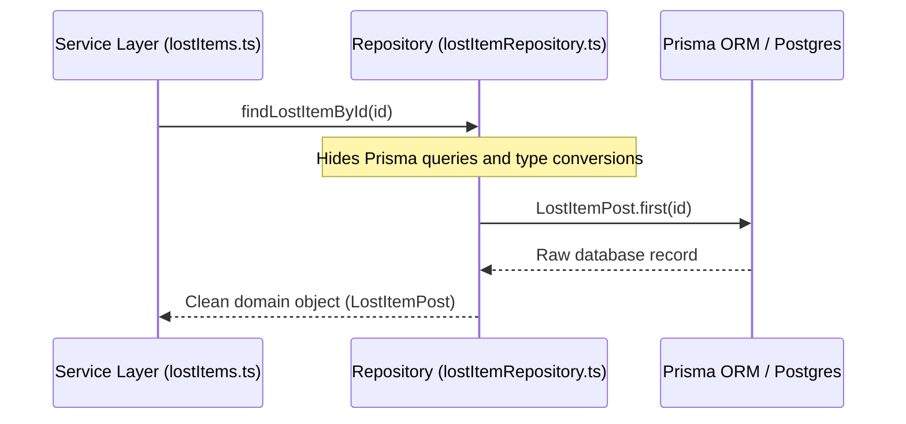
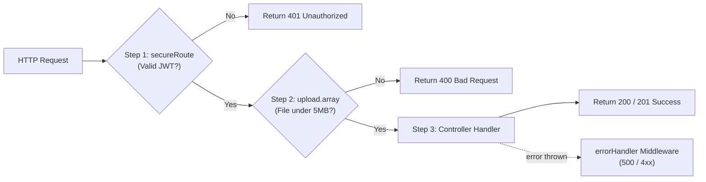
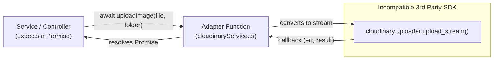
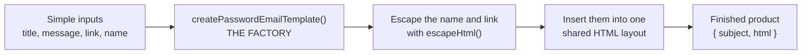
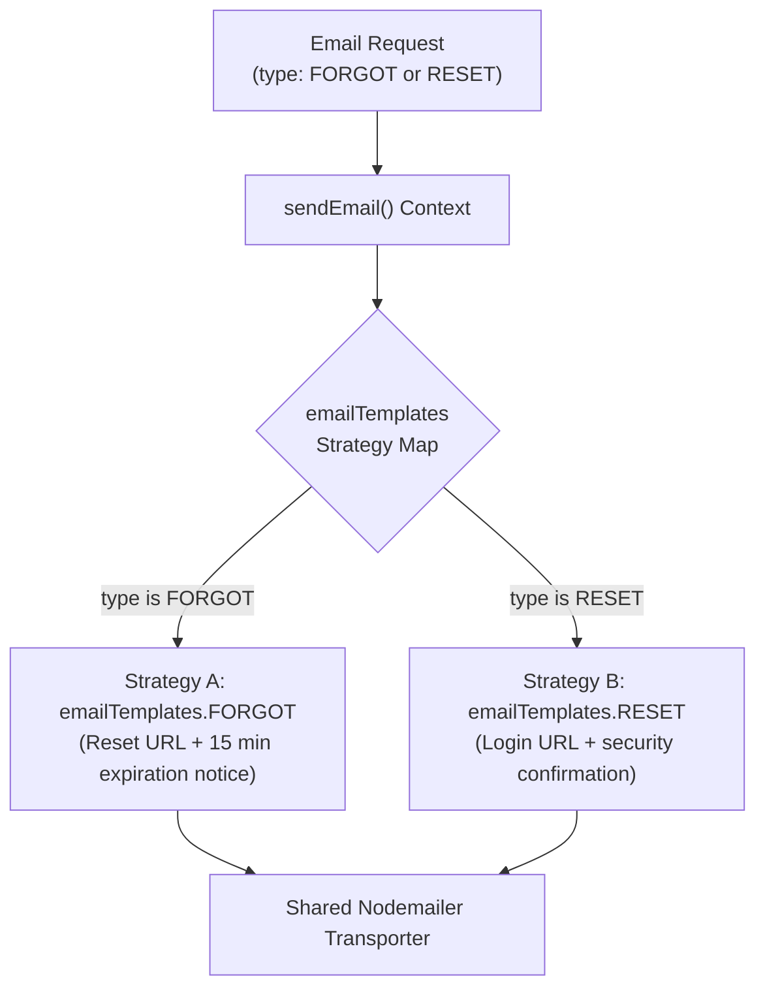
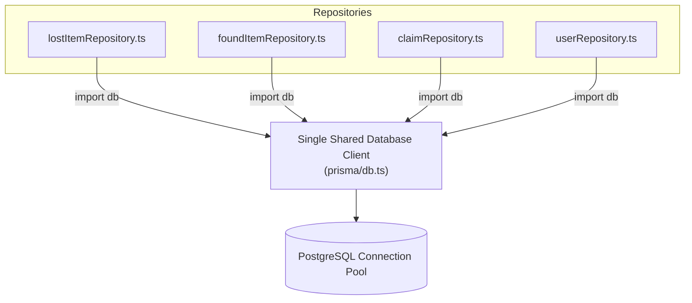
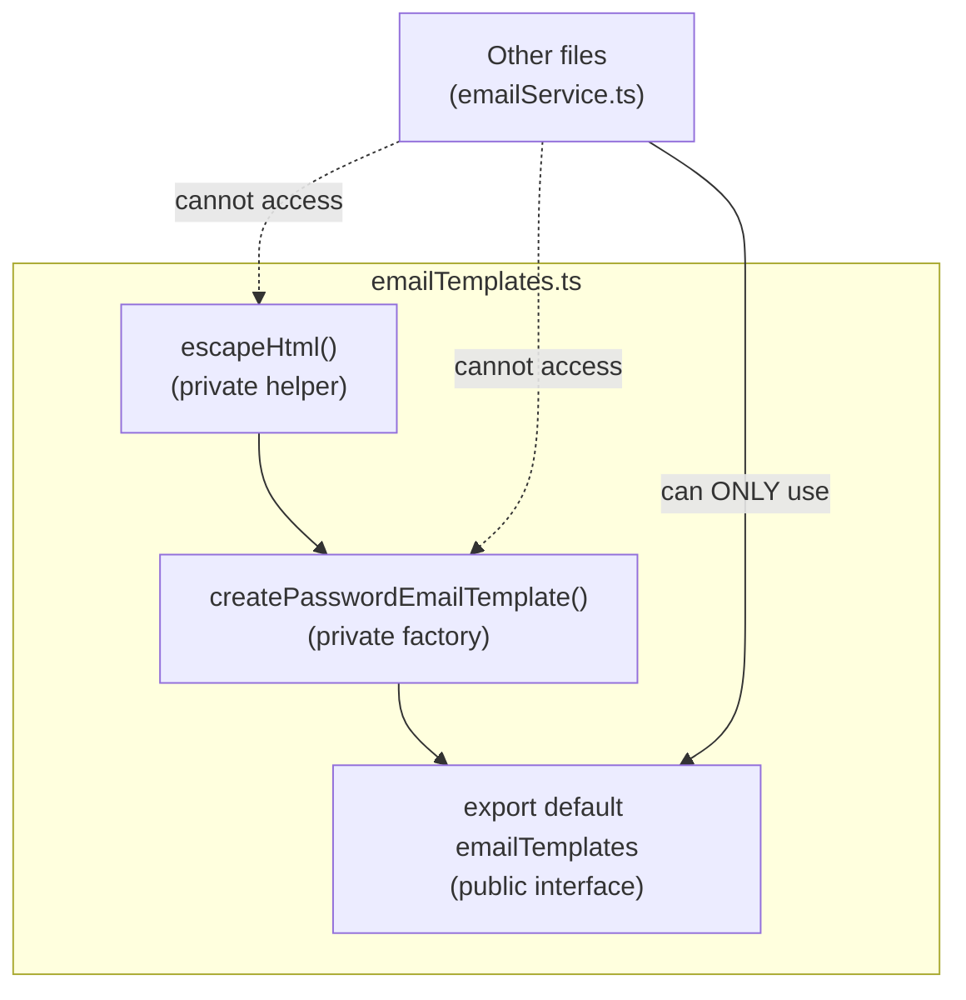

# Software Design Patterns in TrackBack Backend

This document is about the **Design Patterns and Architectural Patterns** used in the **TrackBack Backend**.

---

## 1. Repository Pattern (Data Access Pattern)

### Core Idea
Treat the database like an in-memory collection. The rest of the app asks the repository for data through simple methods (`findLostItemById`, `createLostItem`) without caring about SQL queries or ORM syntax.

### The Problem Without It
If services write raw Prisma/SQL queries directly, business logic becomes tightly coupled to the database. If you change ORMs (for example, Prisma to Drizzle) or alter a table schema, you have to rewrite every service file.

### How TrackBack Implements It
In `src/repositories/lostItemRepository.ts`, all database queries are isolated behind clean functions. The service layer only receives and works with typed domain objects (`LostItemPost`).

### Flow Diagram



### Code Implementation (`src/repositories/lostItemRepository.ts`)

```typescript
// Isolates Prisma schema details and type casting from the service layer
const findLostItemById = async (id: string): Promise<LostItemPost | null> => {
  const lostItemId = id as NonNullable<
    Awaited<ReturnType<typeof db.orm.public.LostItemPost.first>>
  >['id'];

  const result = await db.orm.public.LostItemPost.first({ id: lostItemId });
  if (!result) return null;

  // Returns clean domain object
  return {
    id: result.id,
    title: result.title,
    description: result.description,
    category: result.category,
    lastSeenLocation: result.lastSeenLocation,
    lastSeenDate: result.lastSeenDate,
    status: result.status as LostItemPost['status'],
    photoUrl: result.photoUrl ?? null,
    userId: result.userId,
    createdAt: result.createdAt,
    updatedAt: result.updatedAt,
  };
};
```

---

## 2. Chain of Responsibility Pattern (Behavioral Pattern)

### Core Idea
**Assembly Line Analogy:** Pass a request through a line of specialized workers (middlewares). Each worker either does their job and passes the request to the next worker (`next()`), or stops the line immediately if something is wrong.

### How TrackBack Implements It
Express middleware pipeline:
1. `secureRoute`: Checks the authentication cookie and rejects with 401 if invalid.
2. `upload.array("image")`: Parses file uploads and rejects with 400 if the file is too large.
3. `controller`: Executes the requested action.
4. `errorHandler`: Centralized error safety net that catches any thrown exceptions.

### Flow Diagram



### Code Implementation

**Pipeline in Route (`src/routes/media/media.ts`):**
```typescript
router.post(
  "/image",
  secureRoute,              // 1. Authenticate user
  upload.array("image"),    // 2. Validate and process upload
  uploadController.uploadImage // 3. Run controller
);
```

**Guard Worker (`src/middlewares/secure-route.ts`):**
```typescript
const secureRoute = (req: Request, _res: Response, next: NextFunction) => {
  const token = req.cookies?.token;
  if (!token) {
    return next(new AuthenticationError("Authentication required")); // Stop chain
  }
  try {
    const payload = jwt.verify(token, process.env.ACCESS_TOKEN_SECRET!);
    req.userId = (payload as any).userId;
    return next(); // Pass to next middleware
  } catch {
    return next(new AuthenticationError("Invalid or expired access token"));
  }
};
```

---

## 3. Facade Pattern (Structural Pattern)

### Core Idea
Hide messy implementation details behind a clean, high-level interface.

### How TrackBack Implements It

1. **Routing Facade (`src/routes/gateway.ts`):** Unifies 10 separate module routers (`auth`, `users`, `lost-items`, `found-items`, `claims`, `notifications`, and others) into a single `gateway` router.
2. **Cloudinary Facade (`src/integrations/cloudinary/cloudinaryService.ts`):** Hides complex SDK streaming configuration behind friendly functions (`uploadImage`, `deleteImage`).

### Code Implementation (`src/routes/gateway.ts`)

```typescript
const gateway = Router();

// Hides internal router complexity from app.ts:
gateway.use('/auth', authRouter);
gateway.use('/users', userRouter);
gateway.use('/', claimsRouter);
gateway.use('/found-items', foundItemsRouter);
gateway.use('/lost-items', lostItemsRouter);
gateway.use('/', notificationsRouter);
gateway.use('/media', mediaRouter);
gateway.use('/', matchingRouter);
gateway.use('/items', browseItemRouter);
gateway.use('/my-posts', myPostsRouter);

export default gateway; // app.ts only requires: app.use(gateway);
```

---

## 4. Adapter Pattern (Structural Pattern)

### Core Idea
Convert one interface into another that the caller expects, so incompatible pieces can work together.

### How TrackBack Implements It
`src/integrations/cloudinary/cloudinaryService.ts` acts as an **Adapter**. It takes Cloudinary's callback-based stream API and adapts it into a standard JavaScript `Promise<UploadedImage>`.

### Flow Diagram



### Code Implementation (`src/integrations/cloudinary/cloudinaryService.ts`)

```typescript
// ADAPTER: Converts callback stream into a clean async/await Promise
const uploadImage = (
  file: Buffer,
  folder: CloudinaryFolder,
): Promise<UploadedImage> =>
  new Promise((resolve, reject) => {
    // 3rd-party callback/stream interface
    cloudinary.uploader
      .upload_stream(
        {
          folder: `${cloudinaryRootFolder}/${folder}`,
          resource_type: "image",
        },
        (error, result) => {
          if (error || !result) return reject(error ?? new Error("Upload failed"));

          // Adapts 3rd-party shape into TrackBack's UploadedImage type
          resolve({ url: result.secure_url, publicId: result.public_id });
        },
      )
      .end(file); // pipes buffer into stream
  });
```

---

## 5. Factory Pattern (Creational Pattern)

### Core Idea
**Cookie Cutter Analogy:** A factory is a function that builds a finished object for you. You hand it a few simple ingredients, and it returns a complete product shaped the same way every time.

### The Problem Without It
Every email needs the same HTML boilerplate: a background, a white card, the TrackBack heading, a button, and a footer. Without a factory, every feature would copy and paste about 20 lines of HTML like this:


### How TrackBack Implements It
`createPasswordEmailTemplate` in `src/integrations/email/emailTemplates.ts` is a **factory function**:

- **Input:** 5 simple values (title, message, link, name, and whether it is a reset link).
- **Output:** a ready-to-send `{ subject, html }` object.

The HTML layout is written once, inside the factory, and every email reuses it.

### Flow Diagram



### Before and After

| | Without Factory | With Factory |
|---|---|---|
| Code per email | About 20 lines of HTML | 1 function call |
| Changing the brand color | Edit every email | Edit one place |
| Consistent look | Not guaranteed | Always |

### Code Implementation (simplified)

```typescript
// FACTORY: simple inputs in, finished email out
const createPasswordEmailTemplate = (
  title: string,
  message: string,
  actionUrl?: string,
  recipientName = "Buddy",
  resetLink = false,
): EmailTemplate => ({
  subject: title,
  html: `
    <div class="card">
      <h1>TrackBack</h1>
      <p>Hi ${escapeHtml(recipientName)},</p>   <!-- name inserted safely -->
      <p>${message}</p>                         <!-- message inserted -->
      ${actionUrl ? `<a href="${escapeHtml(actionUrl)}">Continue</a>` : ""}
      <p>${resetLink ? "Link expires in 15 minutes." : "Contact support if this wasn't you."}</p>
    </div>
  `,
});
```
---

## 6. Strategy Pattern (Behavioral Pattern)

### Core Idea
Define a family of interchangeable behaviors and pick the right one at runtime, without changing the code that uses them.

### The Problem Without It
Inside the email sending service, we would write nested `if (type === 'FORGOT') ... else if (type === 'RESET') ...` statements. Adding new email types would require modifying, and risking bugs in, the core email sending logic.

### How TrackBack Implements It
TrackBack defines interchangeable email content strategies (`FORGOT` and `RESET`). At runtime, `sendEmail` selects the required strategy based on `payload.type`, without changing how emails are sent over SMTP.

### Flow Diagram



### Code Implementation

**Strategy Definitions (`src/integrations/email/emailTemplates.ts`):**
```typescript
const emailTemplates = {
  FORGOT: (resetUrl: string, recipientName?: string) =>
    createPasswordEmailTemplate(
      "Reset your Trackback password",
      "We received a request to reset your Trackback password. Click the button below to choose a new password.",
      resetUrl,
      recipientName,
      true, // Strategy parameter: shows 15-minute expiration notice
    ),
  RESET: (loginUrl: string, recipientName?: string) =>
    createPasswordEmailTemplate(
      "Your Trackback password was reset successfully",
      "Your Trackback password has been reset successfully. You can now sign in with your new password.",
      loginUrl,
      recipientName,
      false, // Strategy parameter: shows security contact notice
    ),
};
```

**Executing Strategy at Runtime (`src/integrations/email/emailService.ts`):**
```typescript
const sendEmail = async (payload: EmailTemplatePayLoad) => {
  const from = payload.senderEmail || process.env.EMAIL_FROM;

  // Dynamically selects strategy based on payload type
  const template = payload.type === "FORGOT"
    ? emailTemplates.FORGOT(payload.url, payload.recipientName)
    : emailTemplates.RESET(payload.url, payload.recipientName);

  // Common delivery mechanism
  await transporter.sendMail({
    from,
    to: payload.receiverEmail,
    subject: template.subject,
    html: template.html,
  });
};
```

---

## 7. Singleton Pattern (Creational Pattern)

### Core Idea
Create exactly one instance of an object and share it across the whole application.

### The Problem Without It
Opening a new database connection or re-initializing the database driver on every API request is extremely heavy. It consumes CPU, wastes RAM, and can quickly crash PostgreSQL by hitting the maximum connection limit (`too many connections` error).

### How TrackBack Implements It
In `prisma/db.ts`, TrackBack creates **one single database client instance**. Because of Node.js ES Module caching, this instance is created once and shared across all repository files for the entire lifetime of the server.

### Flow Diagram



### Code Implementation (`prisma/db.ts`)

```typescript
import 'dotenv/config';
import postgres from '@prisma/orm-postgres/runtime';
import type { Contract } from './schema.d';
import contractJson from './schema.json' with { type: 'json' };

// SINGLETON: Instantiated once at startup, reused across all repositories
export const db = postgres<Contract>({
  contractJson,
  url: process.env['DATABASE_URL']!,
});
```

---

## 8. Module Pattern (Structural Pattern)

### Core Idea
Keep internal details private and expose only a small public interface.

### How TrackBack Implements It
TrackBack uses TypeScript / ES Modules to strictly control visibility:
- **Private (internal):** Functions defined without the `export` keyword remain private to that file.
- **Public (interface):** Only functions explicitly marked with `export` can be imported by other files.

### Flow Diagram



### Code Implementation (`src/integrations/email/emailTemplates.ts`)

```typescript
// PRIVATE: Helper is NOT exported. It cannot be called outside this file.
const escapeHtml = (value: string) =>
  value
    .replaceAll("&", "&amp;")
    .replaceAll("<", "&lt;")
    .replaceAll(">", "&gt;")
    .replaceAll('"', "&quot;")
    .replaceAll("'", "&#039;");

// PRIVATE: Factory helper is NOT exported directly.
const createPasswordEmailTemplate = (...) => { ... };

// PUBLIC: Only the strategy dictionary is exported to callers.
const emailTemplates = {
  FORGOT: (...),
  RESET: (...),
};

export default emailTemplates;
```