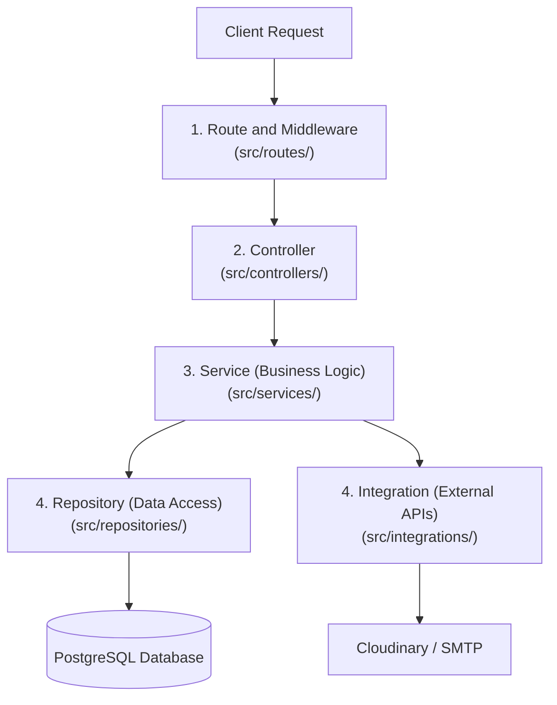

## Project Structure

- `src/routes` - API/Interface layer; defines API endpoints and router composition.
- `src/controllers` - API/Interface layer; translates HTTP requests into application calls and formats responses.
- `src/middlewares` - API/Interface layer; handles request processing and cross-cutting checks such as auth and error handling.
- `src/services` - Application layer; contains business rules and use cases.
- `src/repositories` - Infrastructure layer; handles database access and persistence.
- `src/integrations` - Infrastructure boundary for external providers such as Cloudinary and SMTP email.
- `src/types` - Shared contracts; defines application data and request/response types.
- `src/errors` - Shared application errors with HTTP status and error codes.
- `src/app.ts` - Creates and starts the Express application.

### System context

The frontend is maintained in a separate repository and communicates with this
backend through HTTP API requests. The backend accesses the database and external
providers; this README describes the backend repository only.

The backend runs as one deployable Express application and uses layered
architecture. It is therefore a layered monolith.


## Layered Architecture 

TrackBack uses a layered architecture to keep each kind of responsibility in a focused location:

### Flow Diagram



---

### Why we use this architecture

- **Separation of concerns:** routing, HTTP translation, business decisions,

  persistence, and third-party APIs have distinct responsibilities.

- **Change isolation:** replacing the ORM, database schema access, Cloudinary,

  or SMTP provider is primarily an infrastructure change rather than a

  rewrite of every endpoint.

- **Testability:** services can be tested as use cases without constructing an

  HTTP request, and repositories/integrations can be stubbed at their module

  boundaries.

- **Consistency:** feature modules use the same route -> controller -> service

  -> repository flow, making new modules easier to review and maintain.

- **Team scalability:** We can work on API, business, and persistence

  concerns with fewer accidental dependencies between them.

### Software characteristics improved

This architecture improves the following quality attributes:

- **Modularity:** responsibilities are grouped into replaceable modules and
  feature areas such as lost items, found items, claims, and notifications.

- **Coupling:** the layer boundaries reduce unnecessary coupling between HTTP
  handling, business rules, persistence, and external providers. This is
  reduced coupling, not zero coupling: controllers import service modules,
  services import data-access and integration modules, and those modules use
  shared database or provider clients.

- **Cohesion:** each module is intended to contain closely related
  responsibilities. For example, a lost-item service contains lost-item use
  cases, while the Cloudinary integration contains image-provider operations.
  Some cross-feature coordination remains in modules such as matching and
  claims because those workflows intentionally involve multiple features.

- **Maintainability:** business rules are centralized in services instead of
  being duplicated across route handlers.

- **Extensibility:** new endpoints, use cases, repositories, or provider

  integrations can be added without changing unrelated layers.

- **Portability:** provider-specific code is concentrated in repositories and

  integrations, making infrastructure changes less invasive.

- **Reliability:** shared middleware and centralized error handling apply

  consistent authentication, upload validation, and error responses.

- **Scalability and elasticity:** clear boundaries make it easier to optimize

  or scale expensive concerns independently. The current application is a

  single deployable Express process; the layered design does not by itself

  provide horizontal scaling, queues, or independent service deployment.

- **Security:** authentication and other cross-cutting request checks are

  applied through shared middleware instead of being reimplemented per

  endpoint.


## Cloudinary integration

                Shared upload API

                  │

        ┌─────────▼─────────┐

        │ Cloudinary Service │

        │ uploadImage(s)()   │

        └─────────┬─────────┘

                  ├── USER_PROFILE  -> users/profile

                  ├── LOST_ITEM     -> lost-items/images

                  └── CLAIM_PROOF   -> claims/proof


The Cloudinary code uses a reusable integration module rather than repeating

provider-specific upload logic in each feature:


- `src/integrations/cloudinary/cloudinaryService.ts` is a **Facade and

  Adapter**. It exposes the application-level `uploadImage`,

  `uploadImages`, `deleteImage`, and `deleteImages` functions while adapting

  Cloudinary's stream and callback APIs to promise-based results.

- `src/integrations/cloudinary/cloudinaryFolders.ts` is a **shared module and

  centralized configuration/catalog**. It defines the allowed folder values

  once and exports the `CloudinaryFolder` type, so callers cannot pass

  arbitrary folder strings without bypassing the type contract.

- `src/services/users/users.ts`,

  `src/controllers/media/mediaController.ts`, and

  `src/controllers/claims/claimsController.ts` reuse the same upload service

  with different folder keys.


The design is a reusable integration module that combines the Facade, Adapter,

and centralized-configuration techniques.


### Using Cloudinary folders


`cloudinaryFolders.ts` keeps upload destinations in one place:


```ts

const CLOUDINARY_FOLDERS = {

  USER_PROFILE: "users/profile",

  LOST_ITEM: "lost-items/images",

};

```

Pass the folder key to the upload service to organize the images in cloudinary:

```ts

const images = await uploadImages(files, CLOUDINARY_FOLDERS.LOST_ITEM);


const images = await uploadImages(files, CLOUDINARY_FOLDERS.USER_PROFILE);

```


With `CLOUDINARY_ROOT_FOLDER=trackback-dev`, the images are stored under:
```text

trackback-dev/lost-items/images
```


Use `CLOUDINARY_FOLDERS.USER_PROFILE` for profile images. Add a new key to

`CLOUDINARY_FOLDERS` when a new image category is needed.
